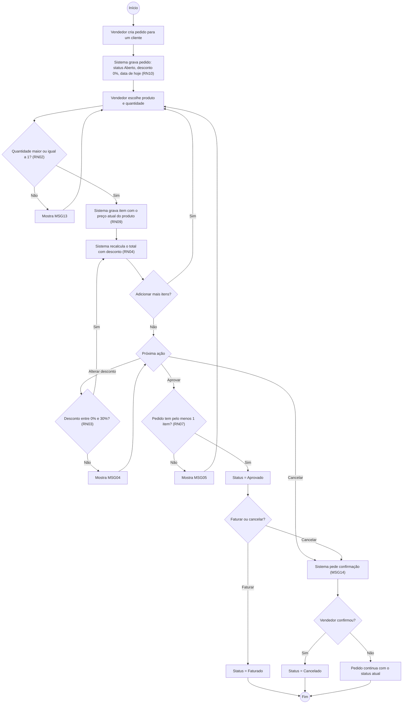

# Diagrama de Atividades – Fluxo do Pedido

Mostra o caminho de um pedido desde a criação até o faturamento ou cancelamento, com os pontos de decisão e as regras de negócio aplicadas.

**Observações**

- Depois de **Aprovado**, o pedido não aceita mais alterações de itens ou desconto (RN05).
- **Faturado** e **Cancelado** são estados finais: nenhum botão de ação aparece na tela.
- Se o vendedor desistir do cancelamento a partir de um pedido Aprovado, o pedido continua Aprovado.
