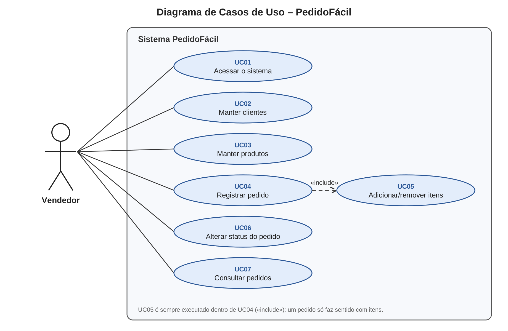

# Casos de Uso – PedidoFácil

**Ator:** Vendedor (único perfil do sistema).

## Resumo dos casos de uso

| Código | Caso de uso | Requisitos | Descrição curta |
|---|---|---|---|
| UC01 | Acessar o sistema | RF01 | Criar conta, entrar e sair |
| UC02 | Manter clientes | RF02, RN01, RN08 | Incluir, listar, buscar, editar e excluir clientes |
| UC03 | Manter produtos | RF03, RN02 | Incluir, listar, editar e excluir produtos |
| UC04 | Registrar pedido | RF04, RF06, RN03, RN04, RN10 | Criar um pedido para um cliente e definir o desconto |
| UC05 | Adicionar/remover itens | RF05, RF06, RN02, RN05, RN09 | Incluir ou retirar produtos do pedido (incluído por UC04) |
| UC06 | Alterar status do pedido | RF07, RN06, RN07 | Aprovar, faturar ou cancelar o pedido |
| UC07 | Consultar pedidos | RF08 | Listar pedidos e filtrar por status |

---

## Descrição detalhada – UC04 Registrar pedido

| Item | Descrição |
|---|---|
| Ator | Vendedor |
| Objetivo | Registrar um pedido de venda para um cliente |
| Pré-condições | Vendedor logado; existe pelo menos um cliente e um produto ativo cadastrados |
| Pós-condição | Pedido gravado com status "Aberto" e com pelo menos um item |
| Inclui | UC05 – Adicionar/remover itens |

**Fluxo principal**
1. O vendedor acessa o menu **Pedidos** e clica em **Novo pedido**.
2. O sistema exibe o formulário com a lista de clientes, desconto 0% e a data de hoje preenchidos.
3. O vendedor escolhe o cliente, informa o desconto (opcional) e clica em **Salvar**.
4. O sistema valida os dados, grava o pedido com status "Aberto" e abre a tela de **Detalhes do pedido** com a mensagem MSG22.
5. O vendedor adiciona os itens (**UC05**).
6. O sistema recalcula e exibe o total do pedido a cada alteração (RN04).

**Fluxos alternativos**
- **3a. Desconto fora do limite:** o sistema mostra MSG04 ao lado do campo e não grava o pedido.
- **3b. Cliente não informado:** o sistema mostra "O campo Cliente é obrigatório." (MSG16).
- **6a. Vendedor altera o desconto depois:** só é permitido enquanto o pedido estiver "Aberto" (RN05); caso contrário, o sistema mostra MSG06.

---

## Descrição detalhada – UC05 Adicionar/remover itens

| Item | Descrição |
|---|---|
| Ator | Vendedor |
| Pré-condições | Pedido existente com status "Aberto" |
| Pós-condição | Lista de itens e total do pedido atualizados |

**Fluxo principal (adicionar)**
1. Na tela de Detalhes do pedido, o vendedor escolhe um produto e informa a quantidade.
2. O sistema mostra o subtotal na tela enquanto a quantidade é digitada (JavaScript).
3. O vendedor clica em **Adicionar**.
4. O sistema verifica se o pedido está "Aberto" (RN05) e se a quantidade é ≥ 1 (RN02).
5. O sistema copia o preço atual do produto para o item (RN09), grava o item e mostra MSG19.
6. O sistema recalcula o total do pedido.

**Fluxo alternativo (remover)**
- **R1.** O vendedor clica em **Remover** em um item; o sistema pede confirmação (MSG07), exclui o item e recalcula o total.

**Fluxos de exceção**
- **4a. Pedido não está aberto:** o sistema mostra MSG06 e não altera nada.
- **4b. Quantidade menor que 1:** o sistema mostra MSG13 e não grava o item.

---

## Descrição detalhada – UC06 Alterar status do pedido

| Item | Descrição |
|---|---|
| Ator | Vendedor |
| Pré-condições | Pedido existente |
| Pós-condição | Pedido com o novo status |

**Fluxo principal**
1. Na tela de Detalhes do pedido, o sistema mostra apenas os botões permitidos para o status atual (RN06).
2. O vendedor clica em **Aprovar**, **Faturar** ou **Cancelar**.
3. Ao cancelar, o sistema pede confirmação (MSG14).
4. O sistema valida a mudança, grava o novo status e mostra MSG20.

**Fluxos de exceção**
- **4a. Aprovar pedido sem itens:** o sistema mostra MSG05 (RN07).
- **4b. Mudança não permitida** (ex.: Faturado → Aberto): o sistema mostra MSG21.

O ciclo de vida completo do pedido está no [diagrama de estados](estados.md).
