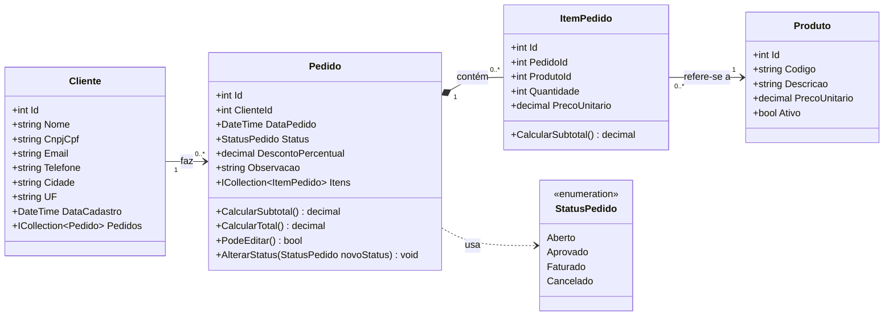
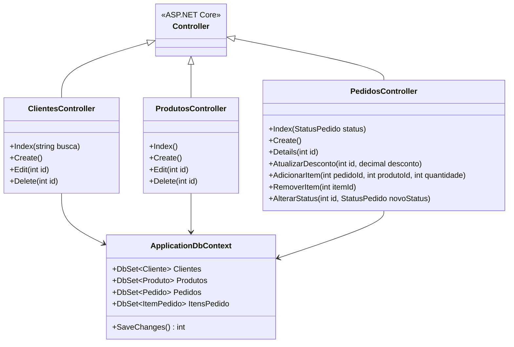

# Diagrama de Classes – PedidoFácil

## 1. Classes de domínio (persistência)

Estas classes ficam na pasta `Models` do projeto (o **M** do MVC) e viram tabelas no banco de dados.

### Explicação

| Elemento | Significado |
|---|---|
| Cliente 1 → 0..* Pedido | Um cliente pode ter nenhum ou vários pedidos; cada pedido pertence a um único cliente |
| Pedido 1 ◆ 0..* ItemPedido | **Composição**: o item só existe dentro do pedido. Se o pedido for excluído, os itens também são |
| ItemPedido 0..* → 1 Produto | Cada item aponta para um produto; um produto pode aparecer em vários itens |
| StatusPedido | Enumeração com os valores Aberto (0), Aprovado (1), Faturado (2) e Cancelado (3) |

### Métodos (regras de negócio dentro do Model)

| Método | Regra | O que faz |
|---|---|---|
| `ItemPedido.CalcularSubtotal()` | RN04 | Quantidade × PrecoUnitario |
| `Pedido.CalcularSubtotal()` | RN04 | Soma dos subtotais de todos os itens |
| `Pedido.CalcularTotal()` | RN04 | Subtotal × (1 − DescontoPercentual ÷ 100), arredondado em 2 casas |
| `Pedido.PodeEditar()` | RN05 | Retorna verdadeiro somente se o status for Aberto |
| `Pedido.AlterarStatus(novo)` | RN06, RN07 | Valida a transição e o número de itens; se for inválida, gera um erro com a mensagem adequada |

Colocar as regras dentro da classe `Pedido` deixa o Controller mais simples e permite testar as regras com testes unitários, sem precisar de banco de dados nem de tela.

**Campos opcionais:** `Email`, `Telefone`, `Cidade`, `UF` (Cliente) e `Observacao` (Pedido). Os demais são obrigatórios. Os tamanhos e domínios de cada campo estão no [dicionário de dados](../05-dados/dicionario-de-dados.md).

---

## 2. Classes da arquitetura MVC

Visão de como as camadas se relacionam. Os **Controllers** recebem as requisições, usam o **DbContext** para ler e gravar os **Models** e devolvem as **Views** (telas Razor).

Todos os Controllers têm o atributo `[Authorize]`: só usuários logados acessam (RNF04). A autenticação (criar conta, login e logout) usa as telas prontas do **ASP.NET Core Identity**.
