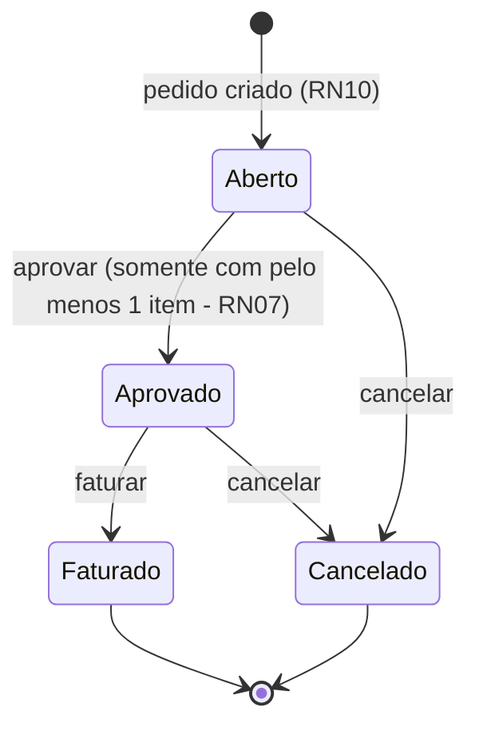

# Diagrama de Estados – Status do Pedido

Complementa o diagrama de atividades mostrando somente as mudanças de status permitidas (RN06).

| Status atual | Ações permitidas | Pode alterar itens e desconto? |
|---|---|---|
| Aberto | Aprovar, Cancelar | Sim |
| Aprovado | Faturar, Cancelar | Não |
| Faturado | Nenhuma | Não |
| Cancelado | Nenhuma | Não |

Qualquer outra mudança (por exemplo, Faturado → Aberto) é bloqueada pelo método `Pedido.AlterarStatus()` com a mensagem MSG21.
