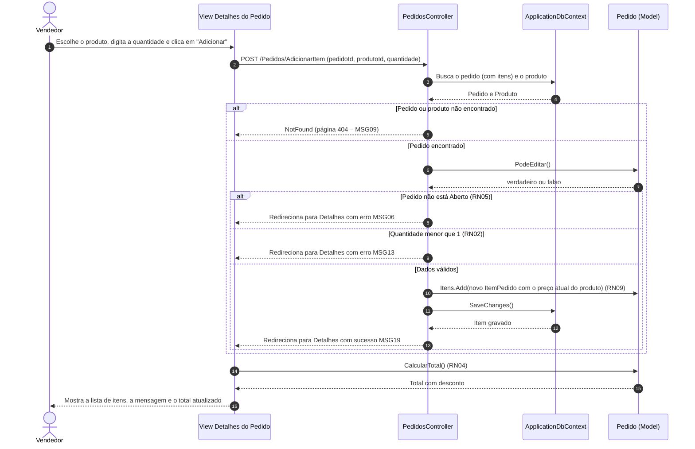
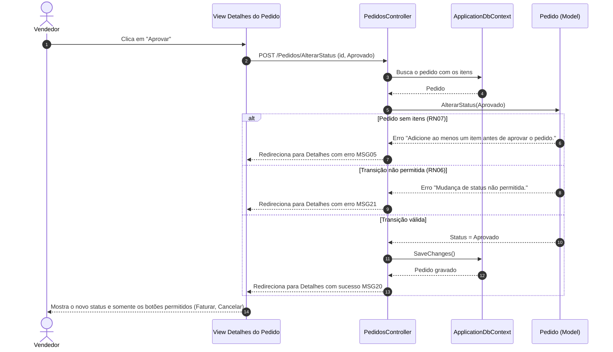

# Diagramas de Sequência – PedidoFácil

Os diagramas mostram a troca de mensagens entre as camadas do padrão MVC: **View** (tela) → **Controller** → **Model** / **DbContext** (banco) → de volta para a **View**.

## 1. Adicionar item ao pedido (UC05)

## 2. Aprovar pedido (UC06)

As mensagens (MSGxx) estão no [catálogo de mensagens](../04-ihc/mensagens.md).
