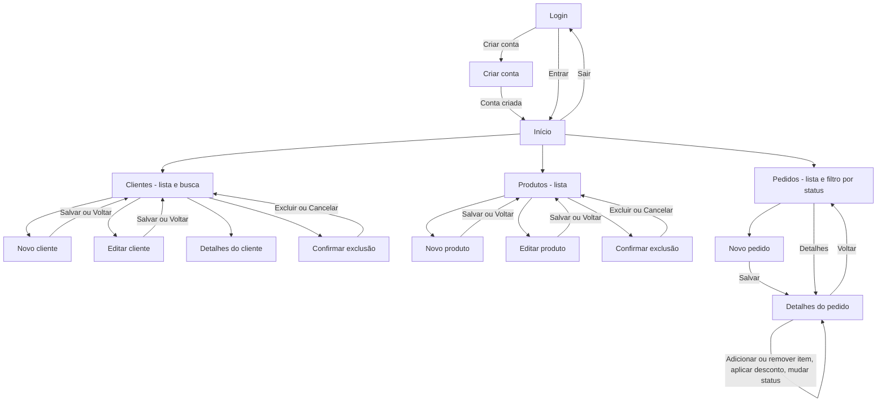

# Mapa de Navegação – PedidoFácil

Mostra como o usuário se movimenta entre as telas. As telas de negócio só podem ser acessadas depois do login.

**Menu superior** (presente em todas as telas após o login): Início · Clientes · Produtos · Pedidos · e-mail do usuário · Sair.

| Tela | Endereço (rota MVC) | Controller / Ação |
|---|---|---|
| Login | /Identity/Account/Login | ASP.NET Core Identity |
| Criar conta | /Identity/Account/Register | ASP.NET Core Identity |
| Início | / | HomeController.Index |
| Clientes | /Clientes | ClientesController.Index |
| Novo / editar cliente | /Clientes/Create · /Clientes/Edit/{id} | ClientesController.Create · Edit |
| Produtos | /Produtos | ProdutosController.Index |
| Pedidos | /Pedidos?status={status} | PedidosController.Index |
| Novo pedido | /Pedidos/Create | PedidosController.Create |
| Detalhes do pedido | /Pedidos/Details/{id} | PedidosController.Details |
| Erro / página não encontrada | /Home/Error · /Home/StatusCode/404 | HomeController |
