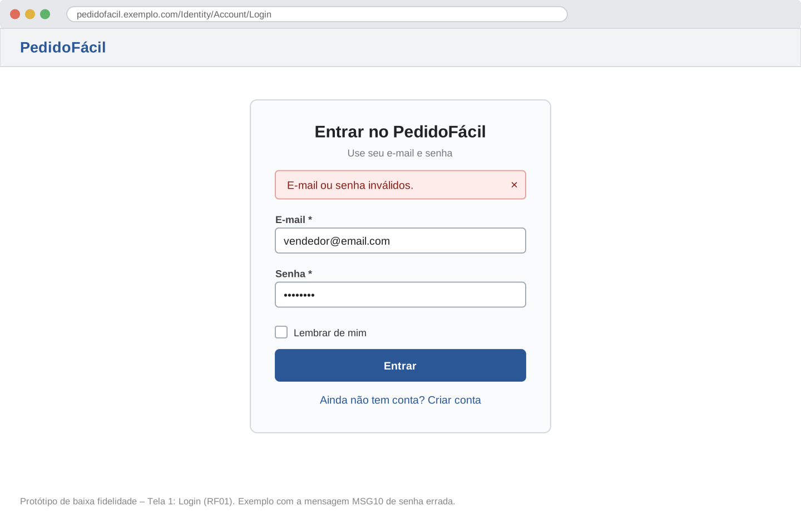
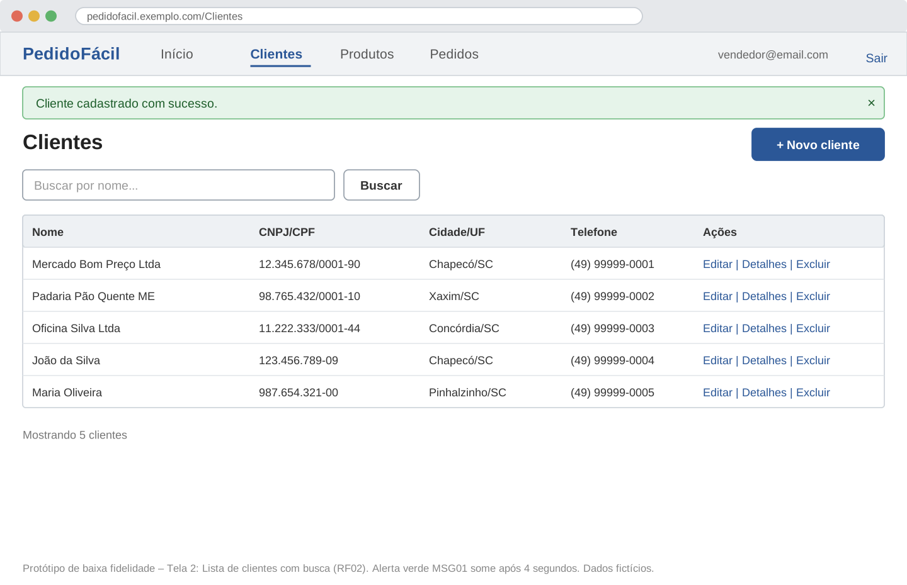
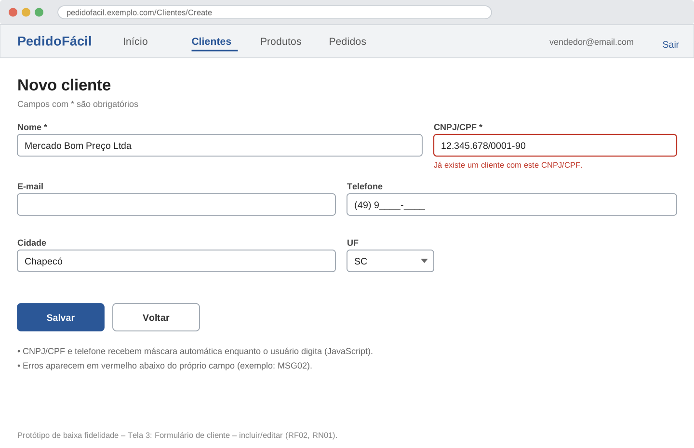
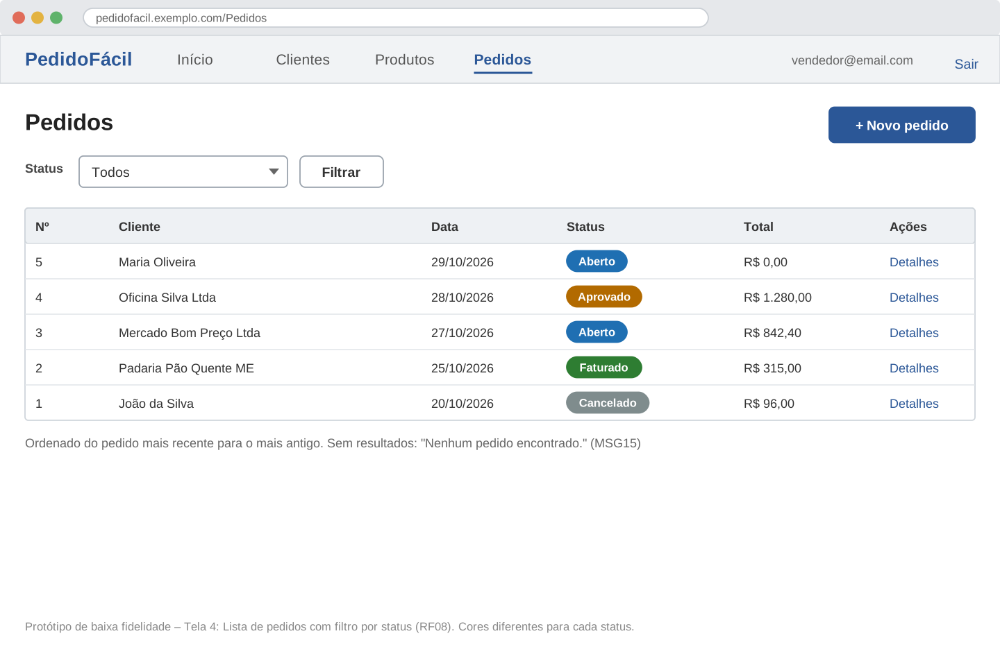
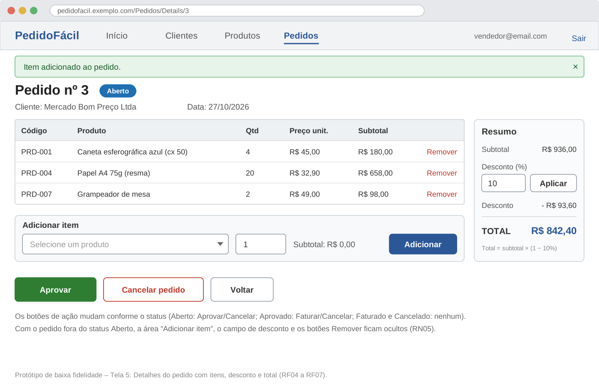
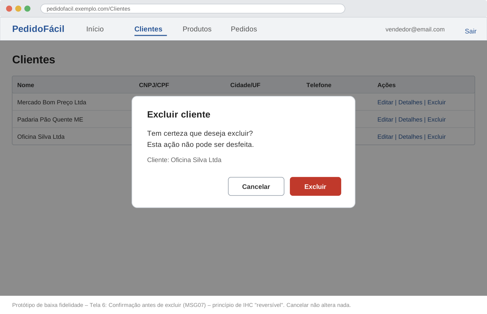

# Protótipo de Telas e Princípios de IHC – PedidoFácil

Protótipo de **baixa fidelidade** (wireframes) das 6 telas principais. Ele define a organização de cada tela antes da programação. Na Situação 2, os prints das telas reais serão acrescentados ao lado de cada wireframe (protótipo incrementado).

O layout segue o padrão do **Bootstrap 5**: barra de menu no topo, conteúdo em uma coluna, botões com cores fixas (azul = ação principal, cinza = voltar, verde = aprovar, vermelho = excluir/cancelar).

## Telas

### Tela 1 – Login (RF01)

### Tela 2 – Lista de clientes (RF02)

### Tela 3 – Formulário de cliente (RF02, RN01)

As telas de **produtos** (lista e formulário) seguem exatamente o mesmo modelo das telas 2 e 3, com os campos Código, Descrição, Preço unitário e Ativo.

### Tela 4 – Lista de pedidos (RF08)

### Tela 5 – Detalhes do pedido (RF04 a RF07)

### Tela 6 – Confirmação de exclusão (MSG07)

---

## Princípios de IHC aplicados

| Princípio | Onde aparece no sistema |
|---|---|
| **Clareza** | Rótulos simples em português ("Novo cliente", "Adicionar item"); asterisco (*) nos campos obrigatórios |
| **Consistência** | Mesmo menu, mesmo layout e mesmas cores de botão em todas as telas; todas as listas têm as ações Editar, Detalhes e Excluir na última coluna |
| **Simplicidade** | Itens do pedido são adicionados na própria tela de detalhes, um de cada vez, sem telas extras |
| **Controle do usuário** | Botão "Voltar" em todos os formulários; o vendedor decide quando aprovar, faturar ou cancelar |
| **Reversível** | Confirmação antes de excluir (MSG07) ou cancelar (MSG14); "Cancelar" na confirmação não altera nada |
| **Dar resposta (feedback)** | Alerta verde após toda ação concluída e alerta vermelho em caso de erro; total recalculado na hora |
| **Direta** | Botões de status aparecem só quando a ação é permitida, evitando cliques que dariam erro |
| **Empática** | Mensagens de erro dizem o que fazer ("Adicione ao menos um item antes de aprovar o pedido.") |
| **Estética** | Visual limpo do Bootstrap, uma cor principal (azul) e cores diferentes por status do pedido |

## Elementos de interface usados

| Tipo | Elementos |
|---|---|
| Controles de entrada | Campos de texto, campo numérico (quantidade, desconto), lista suspensa (cliente, produto, UF, status), caixa de seleção (Ativo, Lembrar de mim), botões |
| Componentes de navegação | Menu superior, links Editar/Detalhes/Excluir, botão Voltar |
| Componentes informativos | Alertas de sucesso e erro, mensagens abaixo dos campos, etiquetas coloridas de status, janela de confirmação |
| Recipientes | Cartão do login, quadro "Resumo" do pedido, quadro "Adicionar item" |

## Boas práticas de usabilidade (usability.gov)

- **Valores padrão:** novo pedido já vem com a data de hoje, desconto 0% e quantidade 1.
- **Comunicar o que está acontecendo:** alertas após cada ação e subtotal calculado enquanto o usuário digita.
- **Cores com propósito:** verde = sucesso/aprovar, vermelho = erro/excluir, azul = ação principal.
- **Layout objetivo:** a informação mais importante da tela de pedido (o TOTAL) fica em destaque no quadro "Resumo".
- **Responsividade:** em telas de celular, o quadro "Resumo" desce para baixo da tabela de itens (grid do Bootstrap).
