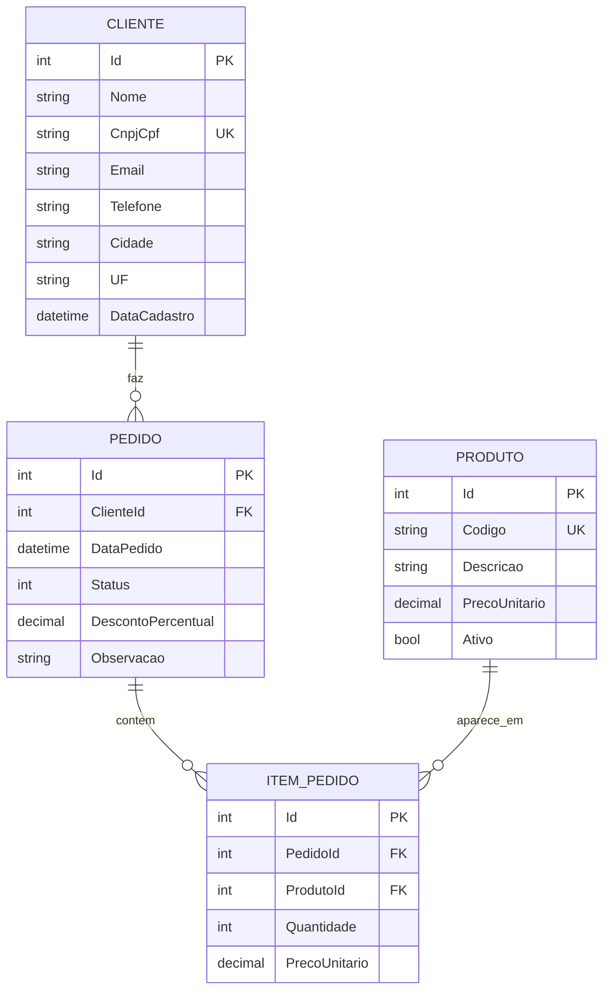

# Modelo Conceitual (DER) – PedidoFácil

O modelo conceitual foi feito a partir do [diagrama de classes de persistência](../03-uml/classes.md): cada classe de domínio virou uma entidade, cada atributo virou um campo e cada associação virou um relacionamento.

Legenda: **PK** = chave primária · **FK** = chave estrangeira · **UK** = valor único.

## Relacionamentos e cardinalidades

| Relacionamento | Cardinalidade | Leitura |
|---|---|---|
| CLIENTE faz PEDIDO | 1 : N (0..*) | Um cliente pode ter zero ou muitos pedidos. Cada pedido pertence a exatamente um cliente. |
| PEDIDO contém ITEM_PEDIDO | 1 : N (0..*) | Um pedido pode ter zero ou muitos itens (zero apenas enquanto está Aberto – para aprovar precisa de pelo menos 1, RN07). Cada item pertence a exatamente um pedido. |
| PRODUTO aparece em ITEM_PEDIDO | 1 : N (0..*) | Um produto pode aparecer em zero ou muitos itens. Cada item se refere a exatamente um produto. |

**ITEM_PEDIDO** é a entidade associativa que resolve o relacionamento **muitos-para-muitos** entre PEDIDO e PRODUTO (um pedido tem vários produtos e um produto está em vários pedidos), guardando também a quantidade e o preço da venda.

## Integridade referencial

| Chave estrangeira | Ao excluir o registro "pai" | Motivo |
|---|---|---|
| PEDIDO.ClienteId → CLIENTE.Id | **Bloqueia** (RESTRICT) | RN08: cliente com pedidos não pode ser excluído |
| ITEM_PEDIDO.PedidoId → PEDIDO.Id | **Exclui em cascata** (CASCADE) | O item não existe sem o pedido (composição) |
| ITEM_PEDIDO.ProdutoId → PRODUTO.Id | **Bloqueia** (RESTRICT) | Não se pode apagar um produto que já foi vendido; o correto é marcá-lo como inativo |

O próximo passo, com as tabelas normalizadas, está no [modelo lógico](modelo-logico.md).
