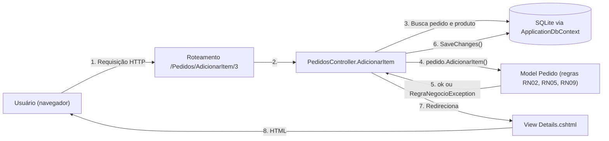

# Arquitetura em Camadas com MVC – PedidoFácil

O sistema usa o padrão **Model–View–Controller (MVC)** do ASP.NET Core. Cada camada tem uma responsabilidade:

| Camada | Pasta | Responsabilidade | Exemplos |
|---|---|---|---|
| **Model** | `Models/` | Dados e regras de negócio | `Pedido` (cálculo do total, regras de status), `Cliente`, `Produto`, `ItemPedido`, `Mensagens` |
| **View** | `Views/` | Telas em HTML (Razor) com Bootstrap e JavaScript | `Views/Pedidos/Details.cshtml`, `Views/Clientes/Index.cshtml` |
| **Controller** | `Controllers/` | Recebe a requisição, chama o Model, grava no banco e escolhe a View | `PedidosController`, `ClientesController`, `ContaController` |
| Acesso a dados | `Data/` | Mapeamento das classes para as tabelas (Entity Framework Core) e dados de exemplo | `ApplicationDbContext`, `DadosIniciais` |
| Infraestrutura | `Infra/` | Ajustes técnicos: mensagens do Identity em português, leitura de números no formato brasileiro | `IdentityMensagensPtBr`, `DecimalBrasilModelBinder` |

## Fluxo de uma requisição



## Decisões de arquitetura

1. **Regras de negócio no Model.** Os métodos `AdicionarItem`, `DefinirDesconto`, `AlterarStatus` e `CalcularTotal` ficam dentro da classe `Pedido`. O Controller fica simples e as regras podem ser testadas sem banco e sem tela (testes unitários).
2. **Erros de regra como exceção com mensagem pronta.** Quando uma regra é violada, o Model lança `RegraNegocioException` com a mensagem do catálogo. O Controller mostra essa mensagem em um alerta vermelho.
3. **Validação em três níveis.**
   - Navegador: jQuery Validation, a partir das anotações dos Models (`[Required]`, `[Range]` etc.);
   - Servidor: as mesmas anotações (`ModelState`) e os métodos do Model;
   - Banco de dados: chaves estrangeiras, índices únicos e regras CHECK.
4. **Banco criado automaticamente.** Ao iniciar, o sistema executa `Database.EnsureCreated()` e grava dados fictícios de exemplo (`DadosIniciais`). Não é preciso rodar nenhum comando para criar o banco.
5. **Autenticação com ASP.NET Core Identity.** As senhas são guardadas com hash. As telas de login e cadastro (`ContaController`) foram feitas em português.
6. **Front-end.** O HTML é gerado pelas Views Razor. O CSS vem do Bootstrap 5 mais o `wwwroot/css/site.css`. O JavaScript (`wwwroot/js/site.js`) faz as máscaras de CPF/CNPJ e telefone, o subtotal ao vivo, as confirmações e o sumiço dos alertas.

## Estrutura do código

```
src/PedidoFacil.Web/
├── Program.cs              configuração: banco, login, idioma pt-BR, erros, rotas
├── Controllers/            HomeController, ContaController, ClientesController, ProdutosController, PedidosController
├── Models/                 Cliente, Produto, Pedido, ItemPedido, StatusPedido, Mensagens, RegraNegocioException
├── ViewModels/             dados das telas de login, cadastro e início
├── Data/                   ApplicationDbContext (mapeamento) e DadosIniciais (dados de exemplo)
├── Infra/                  mensagens do Identity em português e leitura de números (45,90)
├── Views/                  telas Razor (HTML) de cada controller + layout
└── wwwroot/                CSS, JavaScript e ícone

tests/PedidoFacil.Tests/
├── PedidoRegrasTests.cs    testes unitários das regras de negócio
├── ConversaoDecimalTests.cs testes da leitura de valores digitados
├── BancoDeDadosTests.cs    testes de integração com o banco SQLite
└── IntegracaoWebTests.cs   testes de integração das telas (requisições HTTP)
```
