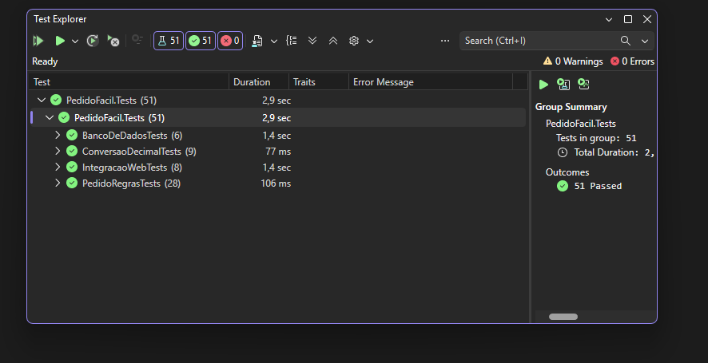

# Relatório de Testes – PedidoFácil

Plano e casos de teste: [plano-de-testes.md](plano-de-testes.md)

## 1. Resumo

| Etapa | Data | Resultado |
|---|---|---|
| Testes automatizados (xUnit) | 03/11/2026 | **51 de 51 aprovados**, 0 falhas, 0 avisos |
| Casos de teste funcionais – 1ª rodada | 03/11/2026 | 1 falha encontrada (CT04 – campo UF) |
| Correção da falha | 03/11/2026 | Versão 1.0.1 |
| Casos de teste funcionais – 2ª rodada | 03/11/2026 | **27 de 27 aprovados** |
| Casos manuais CTM01 a CTM03 | _a preencher_ | _a preencher_ |
| Validação pelos 5 avaliadores | _a preencher_ | _a preencher_ |

## 2. Verificação – testes automatizados

Execução no Visual Studio (Test Explorer): 51 testes aprovados em 4 grupos.

| Grupo | Tipo | Execuções | Resultado |
|---|---|---|---|
| PedidoRegrasTests | Unitário – regras de negócio | 28 | Aprovado |
| ConversaoDecimalTests | Unitário – leitura de valores | 9 | Aprovado |
| BancoDeDadosTests | Integração – banco SQLite | 6 | Aprovado |
| IntegracaoWebTests | Integração – telas (HTTP) | 8 | Aprovado |

## 3. Verificação – casos de teste funcionais

Os 27 casos (CT01 a CT27) foram executados pelo navegador com o sistema rodando localmente (`http://localhost:5080`). A execução foi feita com apoio de uma ferramenta de automação do navegador (Claude no Chrome), seguindo os passos e os resultados esperados definidos no plano. Os resultados foram conferidos pelo desenvolvedor.

| ID | Resultado obtido | Status |
|---|---|---|
| CT01 | Tela "Entrar no PedidoFácil" exibida | OK |
| CT02 | "As senhas não conferem."; depois "Conta criada com sucesso..." e painel 5 · 9 · 1 · 1 | OK |
| CT03 | "E-mail ou senha inválidos."; depois entrou | OK |
| CT04 | 1ª rodada: **falhou** (UF impedia salvar). 2ª rodada: máscaras OK, "Cliente cadastrado com sucesso.", alerta sumiu em ~4,2 s | OK após correção |
| CT05 | "Já existe um cliente com este CNPJ/CPF." | OK |
| CT06 | "O campo Nome é obrigatório." | OK |
| CT07 | Só "João da Silva" e "Oficina Silva Ltda" ("Mostrando 2 cliente(s)") | OK |
| CT08 | "Este cliente possui pedidos e não pode ser excluído." e só o botão Cancelar | OK |
| CT09 | "Registro excluído com sucesso." e o cliente saiu da lista | OK |
| CT10 | "O preço deve ser maior que zero." | OK |
| CT11 | "Produto cadastrado com sucesso." e PRD-011 com R$ 15,90 | OK |
| CT12 | "Já existe um produto com este código." | OK |
| CT13 | Aviso de produto já vendido com os botões Cancelar e "Marcar como inativo" | OK |
| CT14 | "Selecione um cliente." e "O desconto deve estar entre 0% e 30%." | OK |
| CT15 | "Pedido criado com sucesso. Agora adicione os itens.", pedido nº 4, Aberto, 03/11/2026 | OK |
| CT16 | "Adicione ao menos um item antes de aprovar o pedido."; continuou Aberto | OK |
| CT17 | "Subtotal: R$ 74,70" antes de clicar; "Item adicionado ao pedido." e TOTAL R$ 74,70 | OK |
| CT18 | O navegador bloqueou o envio ("valor deve ser maior ou igual a 1"); nada foi adicionado | OK |
| CT19 | Uma linha só, quantidade 5, TOTAL R$ 124,50 | OK |
| CT20 | "Desconto atualizado." e R$ 112,05; com 40%, mensagem de erro e total inalterado | OK |
| CT21 | Status Aprovado; "Adicionar item" e desconto ocultos; botões Faturar e Cancelar pedido | OK |
| CT22 | Status Faturado, nenhum botão de ação e a mensagem de pedido bloqueado | OK |
| CT23 | Pedidos nº 4 (Maria Oliveira, R$ 112,05) e nº 3 (Oficina Silva, R$ 206,15) | OK |
| CT24 | Subtotal R$ 936,00 · Desconto 10% (R$ 93,60) · TOTAL R$ 842,40 | OK |
| CT25 | "404 – Página não encontrada" com o botão "Voltar para o início" | OK |
| CT26 | Menu ☰ com os 4 links e Sair; telas sem rolagem lateral da página (simulado em 390 px) | OK |
| CT27 | Sair levou ao login; /Pedidos também | OK |

### Defeito encontrado e corrigido

| ID | Defeito | Causa | Correção | Versão |
|---|---|---|---|---|
| D01 | Em Clientes > Novo cliente, escolher uma UF (ex.: SC) e salvar mostrava "Informe a sigla do estado com 2 letras." e o formulário não era enviado | A regra de tamanho exato (2 caracteres) era aplicada pela validação do navegador a uma lista de seleção, que conta as opções marcadas (1) em vez do texto escolhido | Regra trocada por "duas letras maiúsculas" (`RegularExpression("^[A-Z]{2}$")`) em `Models/Cliente.cs` | 1.0.1 |

### Observações da execução

- **Tabelas no celular:** em 390 px, as tabelas de Clientes, Produtos e Pedidos rolam para o lado dentro da própria tabela, e o botão Excluir da lista de clientes só aparece rolando. A página em si não rola, então o CT26 passou, mas o ponto ficou registrado como melhoria (ver changelog).
- **Mensagem de quantidade:** a quantidade 0 é bloqueada pelo aviso padrão do navegador, e não pela mensagem do sistema (MSG13). A regra é garantida também no servidor (teste T07).
- **Servidor fora do ar na 1ª rodada:** o sistema estava rodando em modo de depuração do Visual Studio, que encerra o servidor quando a janela do navegador aberta por ele é fechada. Na 2ª rodada, com "Start Without Debugging" (Ctrl + F5), não houve queda.
- **CT26** foi simulado em largura de 390 px; o teste em celular real é o CTM03.

## 4. Validação pelos avaliadores

_Será preenchido com o resumo das 5 avaliações: quem testou, o que funcionou, o que não funcionou, o que não foi testado e as sugestões. O PDF completo fica em `avaliacoes-pares.pdf`._

## 5. Pendências conhecidas

| Item | Situação |
|---|---|
| RNF06 – desempenho com 1.000 registros | Ainda não medido |
| CTM01 a CTM03 | A executar |
| Validação com os 5 avaliadores | A executar |
